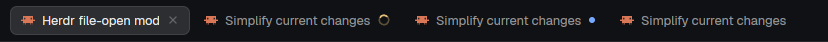

# Agent tab names

Each tab is named after the agent running in it: the title Claude Code (or any agent) gives its session, such as "Herdr file-open mod", replaces the tab's number in the tab bar. Tabs you name yourself keep your name. This adds no visible element to your layout.

This file is the brief: enough to build Agent tab names from an empty folder. The files next to it are one build of it. If they don't work on your Herdr, or you want it different, build it again from here.

## What you see

- Nothing new on screen. The tab bar shows agent titles where it showed `1`, `2`, `3`.
- The name is the agent's terminal title without its leading spinner or status glyphs (`✳ Fix login` and `⠂ Fix login` both become `Fix login`). This is the same text the agents list shows after the space name.

## How it behaves

- Every agent status (working, blocked, done, idle) is treated the same way. Only the title matters.
- A tab nobody named takes the title of its first agent pane, in `panes()` order, whose title is useful. A title is not useful when it is empty, equals the program's name (`Claude Code`) or key (`claude`), is a path (`~/…`, `/…`, `C:\…`, checked before glyphs are stripped) or contains `@` (a shell's `user@host`).
- A tab the mod named follows the title as it changes, checked every 1000 ms.
- A tab someone else named (double-click, `tab.rename`, `tab.new {name}`) is never renamed. Renaming it to `""` gives it back its number, and the mod takes it again.
- When the agent exits or the pane becomes a shell, the tab keeps its last name.
- Mod panes and shells never name a tab.
- Tabs on a machine whose `machines()` layout is not `ready` are skipped until it is.

## Built from

- **One mod**, `mods/agent-tab-names/`, with `main.js`, `names.js` and `mod.json` (`{ "place": "none", "title": "Agent tab names" }`). `render()` returns an empty `div()`.
- **Its host:** a mod runs only while a layout block holds it, so the person adds a floating block to the root of their own layout: `{ "id": "agent-tab-names", "content": { "mod": "agent-tab-names" }, "edge": "bottom", "align": "end" }`. Shipped layouts are read-only: clone first.
- **`names.js`** is pure, with no `herdr` imports, so `node --test` runs it. It has `clean`, `telling` and `plan(tabs, panes, owned, {keep})`. `plan` returns `{renames, owned}`.
- **`main.js`** runs `cx.timer.every(1000, tick)`. A tick reads `machines()`, `spaces()` and `panes()`, calls `run("tab.rename", {id, name})` for each rename, and calls `setShared` only when `owned` changed, because every `setShared` re-renders every mod.
- **Ownership:** shared key `agent-tab-names.owned` is `{tabId: [names]}`, the names the mod gave each tab. It has two names while a rename is in flight, `[current, requested]`, so a rename that fails (or lands just before a restart) is still recognised as ours and retried. A tab whose name is not in its list belongs to the person and is dropped from the map. Closed tabs are pruned, except while some machine is unavailable (`keep`).
- Herdr functions: `machines`, `spaces`, `panes`, `run`, `shared`, `setShared`. No `exec`, `hc`, file reads or network.

## Watch out

- Once renamed, a tab is `named: true` to Herdr. Without the ownership map the mod could not tell its own names from the person's after a restart. That is why the map lives in shared state, not in memory.
- If the person renames a tab to exactly the title the mod set, it stays the mod's.
- Strip glyphs with `/^[^\p{L}\p{N}]+/u` (as the shipped `agents` mod does), but test for paths on the raw title, or `~/src` becomes `src` and passes.
- The floating block must stay invisible. If your Herdr draws a frame around an empty floating mod, report it, or host the mod in a block you already have.
- Long titles are cut by the tab bar itself (the shipped `tabs` mod truncates at 170px).

## Done when

- `node --test tests/` and `herdr-app check mods/agent-tab-names` pass.
- With the floating block added, a tab running Claude Code shows the session title within a second, and changes when the title does.
- Double-clicking a tab and naming it stops the mod from renaming it, also after restarting Herdr.
- Renaming a tab to `""` hands it back: it takes the agent's title again.
- A tab with only a shell keeps its number. A tab whose agent exited keeps the last title.
- Nothing new is visible in the layout.
